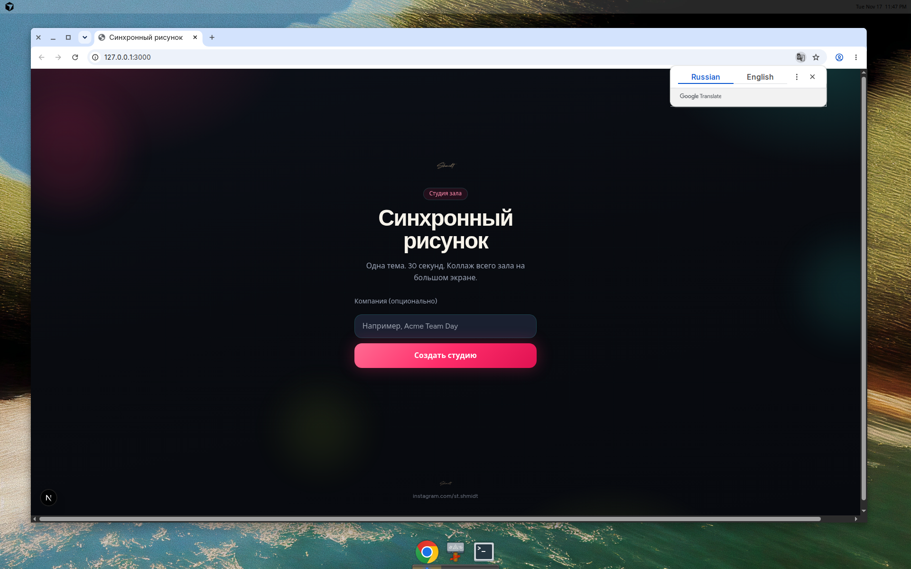
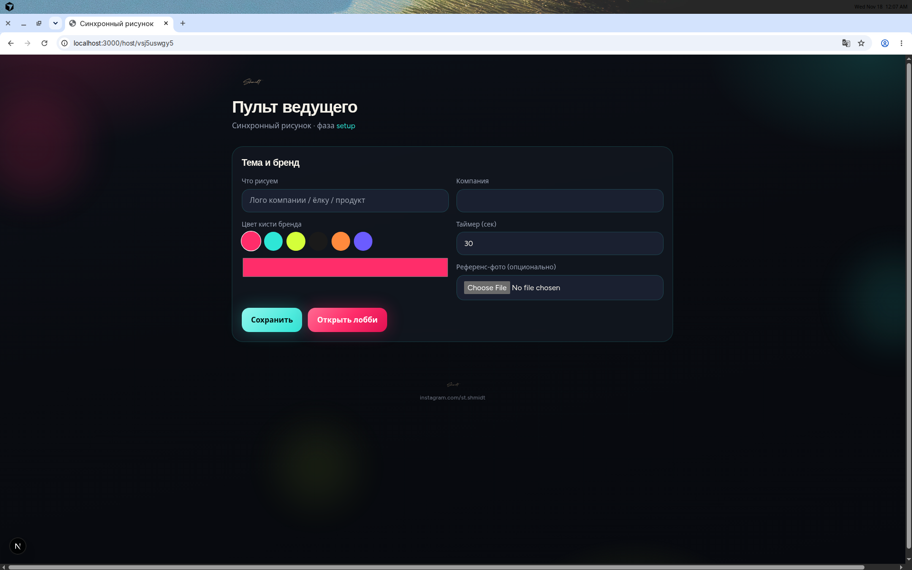
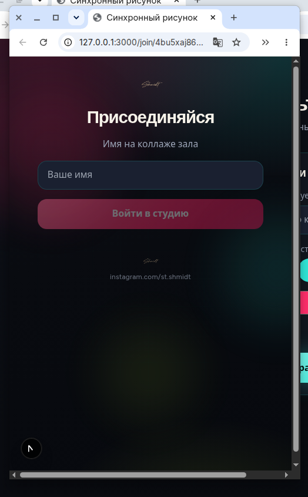
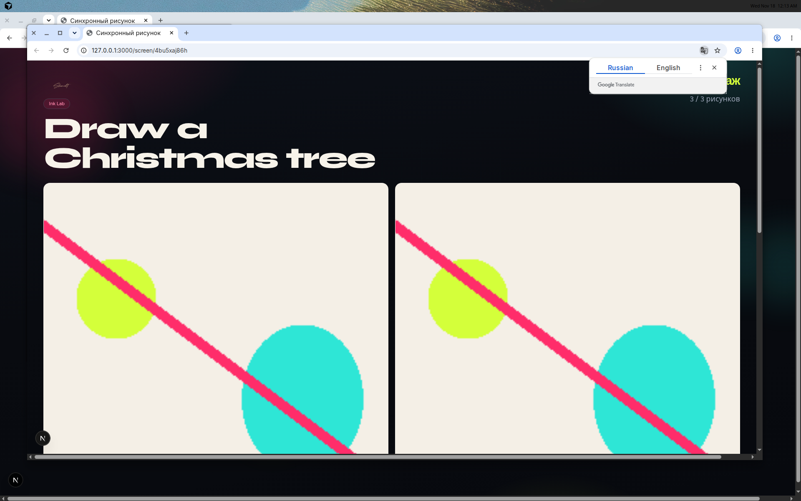

# Синхронный рисунок

Корп-интерактив: ведущий задаёт тему и цвет кисти, гости 30 секунд рисуют на телефоне, экран зала собирает live-коллаж.

## Роли

- **Ведущий** — тема, референс-фото, цвет бренда, QR, старт таймера.
- **Гость** (телефон) — имя + canvas пальцем, палитра цветов.
- **Экран зала** — QR для входа, live-плитки, клик по рисунку → автор / стереть / бан.

## Запуск локально

```bash
cd next-app
npm install
env -u DATABASE_URL npm run dev
```

Откройте http://127.0.0.1:3000

Без `DATABASE_URL` — in-memory PGlite. На Cursor Cloud Apps платформа поднимает Postgres.

## Токены

- Host / guest session / screen — `Authorization: Bearer` или `sessionStorage`.
- Экран: `#s=…` (hash), не query.
- В QR гостя только access-ключ `?k=` (не session token).

## Publish

Папка: `next-app/` (`cursor-app.json` → Postgres).

Лого: `brand/logo.png` и `next-app/public/brand/logo.png`. Instagram в футере кликабелен.

## Скрины









## Не делаем

Соц-фид, AI-дорисовка, аккаунты.
